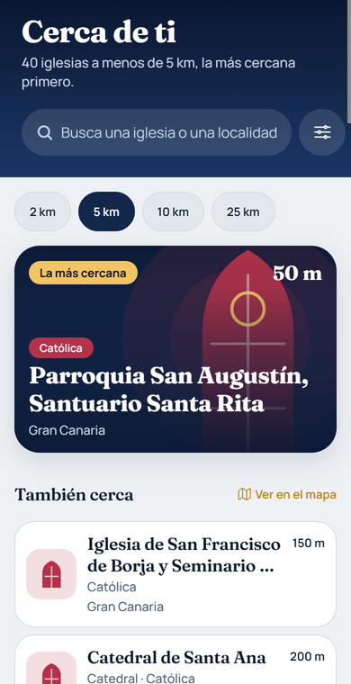
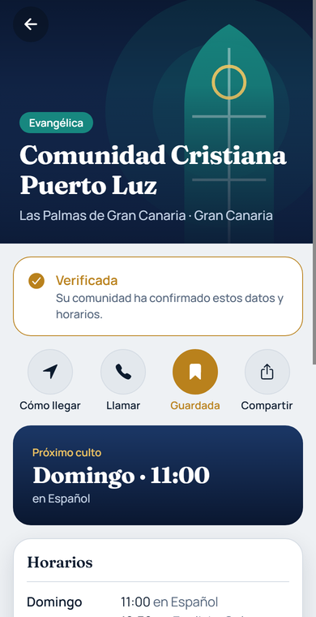
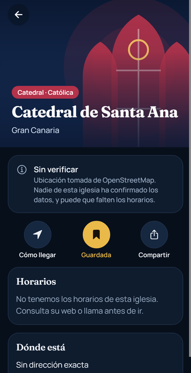
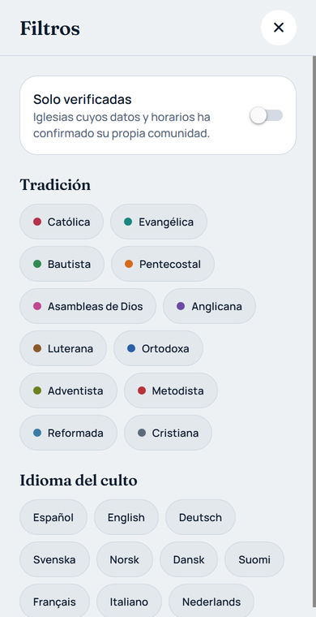
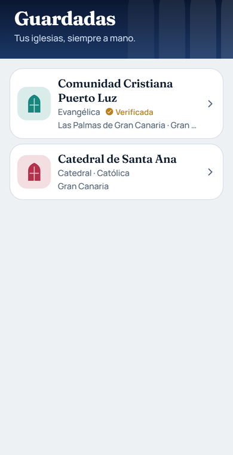
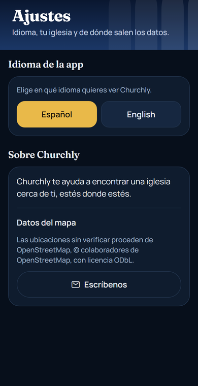

# Churchly

**Churchly** helps you find a church near you, wherever you are. It opens on the churches closest
to your location, nearest first, and also shows them on a map. It covers more than 35,000 places
of worship across Spain, from every Christian tradition, and each one has its own page with
directions, service times, languages and contact details.

There are two kinds of church pages:

- **Verified**: added or confirmed by the congregation itself through the companion web portal,
  [churchly-web](https://github.com/FelipeMartel/churchly-web), with their service times.
- **Unverified**: locations imported from OpenStreetMap. They have a name, a tradition and a
  position, but no service times, and the app says so.

> Personal project. Working prototype, not published on the app stores. The interface is in
> English and Spanish.

<p>
  
  
  
</p>
<p>
  
  
  
</p>

<sub>Screenshots taken from the web preview with real OpenStreetMap data around Las Palmas de Gran
Canaria. «Comunidad Cristiana Puerto Luz» is a fictional church used to show a verified page. On a
phone the tab bar sits at the bottom, and the map tab shows the native map.</sub>

## What it does

- **Nearest first.** The home screen lists the churches around you sorted by real distance, with
  the closest one highlighted. You choose how far to look: 2, 5, 10 or 25 km.
- **Map.** Every church as a stained-glass arch coloured by its tradition; verified ones carry a
  gold outline. When there are too many on screen they are grouped into clusters that open as you
  zoom in.
- **Church page.** Next service at a glance, the full weekly schedule, languages, address, and
  one-tap actions: directions, call, save and share. Any data error can be reported by email.
- **Search and filters.** Search by church name, town or island, ignoring accents. Filter by
  tradition, service language or verified churches only.
- **Saved churches**, kept on the device.

## How it is built

| Layer | Technology |
| --- | --- |
| App | Expo SDK 57, React Native 0.86, TypeScript, Expo Router (native tabs), TanStack Query, `react-native-maps` |
| Backend | Supabase (PostgreSQL with row-level security) |
| Web portal | Next.js, in [churchly-web](https://github.com/FelipeMartel/churchly-web) |
| Data | OpenStreetMap, through a custom import pipeline |

### Geo logic in the database

The app never downloads the whole catalogue. Three PostgreSQL functions do the work and answer in
under 100 ms over the full dataset:

| Function | Returns |
| --- | --- |
| `churches_near` | The churches within a radius of a point, sorted by real (haversine) distance |
| `churches_in_view` | The churches inside the visible map area, grouped into a grid of clusters when there are too many |
| `churches_search` | Matches by name, town or island, accent-insensitive, nearest first |

The schema is versioned as SQL migrations, with row-level security and **17 automated database
tests** (pgTAP) covering the map functions and write permissions.

### OpenStreetMap import

[`scripts/import-osm-churches.mjs`](scripts/import-osm-churches.mjs) builds the catalogue:

1. Downloads Christian places of worship from the Overpass API, tile by tile.
2. Assigns each one to its Spanish region with point-in-polygon tests against official
   boundaries, and drops those that fall in neighbouring countries.
3. Maps OSM tags to a tradition (Catholic, Evangelical, Orthodox, Anglican…) and a type (church,
   cathedral, chapel, hermitage, monastery).
4. Writes idempotent SQL upserts keyed by the OSM id, so re-running it updates places without
   duplicating them and never overwrites a verified church.

Result: **35,280 named places of worship** in all 19 Spanish regions, 760 of them in the Canary
Islands.

## Project structure

```
src/app          screens (Expo Router): near you, map, saved, settings, church page, search, filters
src/components   UI: map, stained-glass arch, cards, headers
src/features     church data: API calls, queries and shared state
src/theme        «Vidriera» palette, typography and spacing
src/i18n         English and Spanish texts
supabase         migrations and database tests
scripts          OpenStreetMap importer and icon generator
```

## Running it locally

Requirements: Node 20+, Docker and the Expo Go app.

```bash
npm install
npx supabase start             # local database with every migration, including the catalogue
cp .env.example .env           # then fill in the URL and anon key from `npx supabase status`
npx expo start
```

| Variable | Purpose |
| --- | --- |
| `EXPO_PUBLIC_SUPABASE_URL` | Supabase project URL |
| `EXPO_PUBLIC_SUPABASE_ANON_KEY` | Public (anon or publishable) key |
| `EXPO_PUBLIC_SUBMISSION_URL` | Optional. URL of churchly-web; enables «Add my church» in Settings |

```bash
npx supabase test db                            # database tests
node scripts/import-osm-churches.mjs            # download from OSM and regenerate the migrations
node scripts/import-osm-churches.mjs --offline  # regenerate the SQL from the local cache
```

### First deployment to an existing project

The Supabase project existed before the schema was versioned.
`20260101000000_esquema_base.sql` mirrors what was already there, so it is marked as applied
instead of run:

```bash
npx supabase link --project-ref <ref>
npx supabase migration repair --status applied 20260101000000
npx supabase db push
```

## Data and credits

Unverified locations are © [OpenStreetMap](https://www.openstreetmap.org/copyright) contributors,
available under the [ODbL](https://opendatacommons.org/licenses/odbl/). The app credits them in
Settings and on every unverified church page.

## Licence

**All rights reserved.** The code is public so it can be read and reviewed, not reused: it may
not be run, copied, modified or used in another product without written permission. See
[LICENSE](LICENSE). OpenStreetMap data and third-party dependencies keep their own licences.
